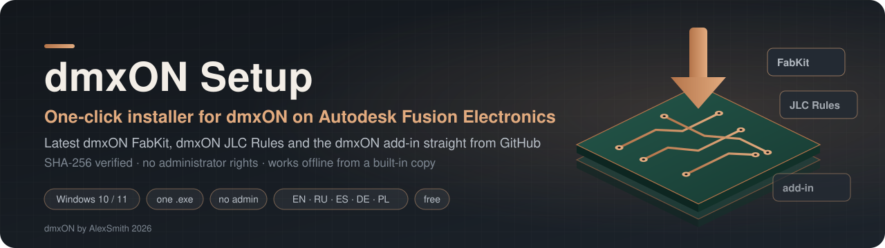
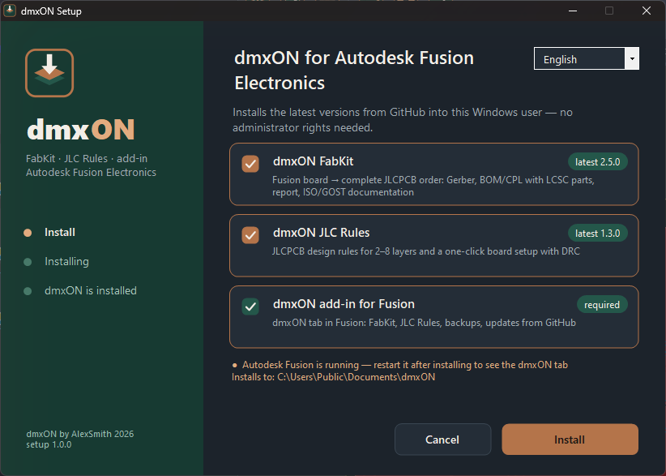
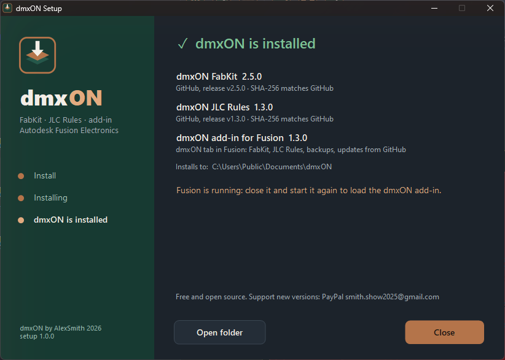
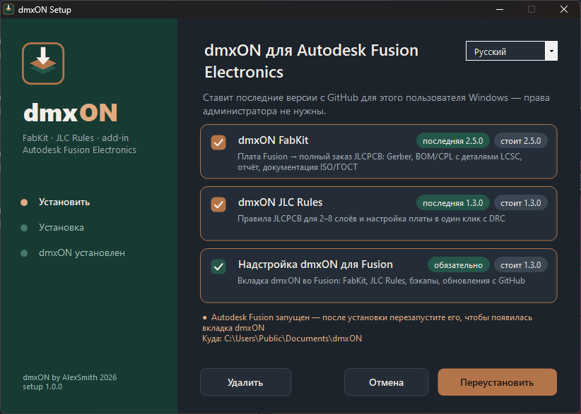
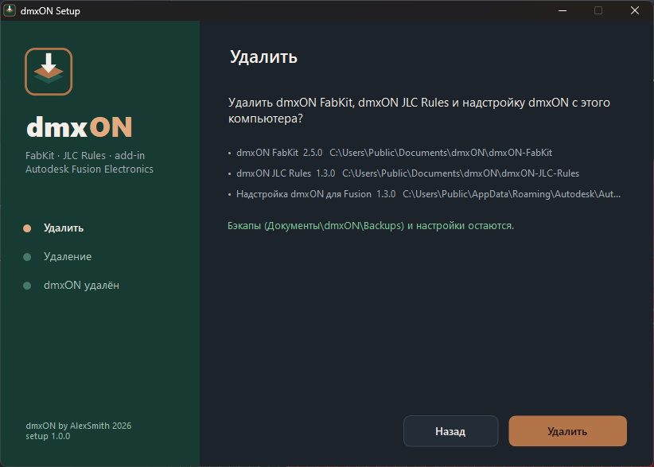

<p align="center">
  
</p>

<p align="center">
  <a href="https://github.com/AlexSmith2025/dmxON-Setup-Fusion-Electronics/releases/latest"></a>
  <a href="https://github.com/AlexSmith2025/dmxON-Setup-Fusion-Electronics/releases"></a>
  
  
  <a href="https://www.paypal.com/donate/?business=smith.show2025%40gmail.com&no_recurring=0&item_name=dmxON&currency_code=EUR"></a>
</p>

<p align="center">
  <a href="https://github.com/AlexSmith2025/dmxON-Setup-Fusion-Electronics/releases/latest/download/dmxON-Setup.exe"></a>
</p>

<p align="center">
  <b>English</b> · <a href="README.ru.md">Русский</a> · <a href="README.es.md">Español</a> · <a href="README.de.md">Deutsch</a> · <a href="README.pl.md">Polski</a>
</p>

**One `.exe` that installs the whole dmxON toolset for Autodesk Fusion Electronics (Fusion 360 Electronics) on any Windows 10/11 computer: it downloads the latest [dmxON FabKit](https://github.com/AlexSmith2025/dmxON-FabKit-Fusion-Electronics) and [dmxON JLC Rules](https://github.com/AlexSmith2025/dmxON-JLC-Rules-Fusion-Electronics) from GitHub, checks them, and sets up the dmxON add-in so that Fusion gets a dmxON tab.**

<p align="center">
  
  
</p>

---

## What it does

| | |
|---|---|
| ⬇️ | Downloads the **latest releases** of dmxON FabKit and dmxON JLC Rules from GitHub at install time — the installer never goes out of date |
| 🔒 | Checks every archive: **SHA-256 against GitHub**, the zip structure and the key files; a damaged or tampered download is rejected |
| 🧩 | Installs the **dmxON add-in** for Fusion: a **dmxON** tab in the PCB and schematic editors (FabKit, JLC Rules, Backup, Updates); on the first start it registers the dmxON folders in Fusion's ULP, design-rule and CAM lists |
| 👤 | **No administrator rights**: everything goes into the current Windows user (`Documents`, `AppData`, `HKCU`) |
| 🌍 | Works on **any machine**: Documents moved to OneDrive or another drive, user names with spaces or Cyrillic, corporate proxy, TLS 1.2 |
| 📴 | **Offline fallback**: when GitHub cannot be reached, the copy built into the `.exe` is installed |
| ♻️ | **Update / reinstall** keeps your own files (for example board rules in `rules\`); each tool folder is replaced in one step with rollback |
| 🗑️ | Appears in **Settings → Apps → Installed apps** as «dmxON for Autodesk Fusion Electronics» — remove it from there or from the installer |
| 🌐 | **5 languages**: English, Русский, Español, Deutsch, Polski (picked from Windows, switchable in the window) |

---

## Install

1. [**Download `dmxON-Setup.exe`**](https://github.com/AlexSmith2025/dmxON-Setup-Fusion-Electronics/releases/latest/download/dmxON-Setup.exe) and run it.
2. Windows SmartScreen may say «Windows protected your PC» — the file is not code-signed. Press **More info → Run anyway**. The SHA-256 of every build is in its release notes.
3. Leave both tools ticked (or untick one) and press **Install**. It takes a few seconds.
4. Start **Autodesk Fusion** (restart it if it was open). The PCB and schematic editors now have a **dmxON** tab.

Updating later: run `dmxON-Setup.exe` again (it shows the installed and the latest versions and offers **Update**), or use **dmxON → Updates** inside Fusion.

<p align="center">
  
  
</p>

---

## Where things go

| What | Where |
|---|---|
| dmxON FabKit | `Documents\dmxON\dmxON-FabKit` |
| dmxON JLC Rules (with the rule pack in `rules\`) | `Documents\dmxON\dmxON-JLC-Rules` |
| dmxON add-in | `%APPDATA%\Autodesk\Autodesk Fusion 360\API\AddIns\dmxON` |
| Installer copy for removal, log | `%LOCALAPPDATA%\dmxON\` (`setup.log`) |
| Uninstall entry | `HKCU\Software\Microsoft\Windows\CurrentVersion\Uninstall\dmxON` |

Fusion's folder settings are shared by all computers of an Autodesk account, so the add-in stores them as `$HOME\dmxON\…` — they are valid on every computer where dmxON is installed.

---

## Command line

```
dmxON-Setup.exe                 window
dmxON-Setup.exe /S              silent install or update (exit code 0 = OK, 1 = error)
dmxON-Setup.exe /uninstall      remove (window; add /S for silent)
dmxON-Setup.exe /lang=ru        language: en, ru, es, de, pl
dmxON-Setup.exe /offline        install the built-in copy, no network
```

Useful for deploying to several workstations: `dmxON-Setup.exe /S` per user.

---

## Requirements

- Windows 10 or 11, 64-bit. .NET Framework 4.8 is part of Windows — nothing else to install.
- Autodesk Fusion with Electronics. Fusion may be installed after dmxON: the add-in is loaded the next time Fusion starts.
- Internet access to `github.com` for the latest versions (optional: without it the built-in copy is used).

---

## Troubleshooting

| Problem | Answer |
|---|---|
| «Windows protected your PC» | **More info → Run anyway**. The installer is not code-signed; compare its SHA-256 with the release notes if in doubt |
| No **dmxON** tab in Fusion | restart Fusion once; or **Utilities → Add-Ins → Scripts and Add-Ins → dmxON → Run** |
| «GitHub is not reachable» | the built-in versions are installed; run the installer again later or use **dmxON → Updates** |
| Something failed | **Open log** in the installer, or open `%LOCALAPPDATA%\dmxON\setup.log`, and [open an issue](https://github.com/AlexSmith2025/dmxON-Setup-Fusion-Electronics/issues) with it |

---

## Build from source

```
python build.py
```

Needs Windows, Python 3 with Pillow and internet. It downloads the latest dmxON releases (embedded as the offline fallback), draws the icon and compiles `src/Setup.cs` with the C# compiler of .NET Framework 4.8 (`%WINDIR%\Microsoft.NET\Framework64\v4.0.30319\csc.exe`, part of Windows) into `dist\dmxON-Setup.exe`. The source is one file: WinForms UI, download with retries and proxy support, SHA-256 check against the GitHub release, zip validation, atomic folder replacement with rollback, add-in install, uninstall entry.

---

## The dmxON tools

| | |
|---|---|
| [**dmxON FabKit**](https://github.com/AlexSmith2025/dmxON-FabKit-Fusion-Electronics) | Fusion Electronics board → complete JLCPCB order: Gerber, BOM and CPL with LCSC parts, report, ISO/GOST documentation, design backup |
| [**dmxON JLC Rules**](https://github.com/AlexSmith2025/dmxON-JLC-Rules-Fusion-Electronics) | JLCPCB design rules for 2, 4, 6 and 8 layers and a one-click board setup with stack-up, DRC and a dot grid |

---

## Support the project

<p align="center">
  <a href="https://www.paypal.com/donate/?business=smith.show2025%40gmail.com&no_recurring=0&item_name=dmxON&currency_code=EUR"></a>
</p>

---

## License

Free to use; attribution required; no modification or commercial redistribution — see [LICENSE.md](LICENSE.md). **dmxON by AlexSmith 2026.**
